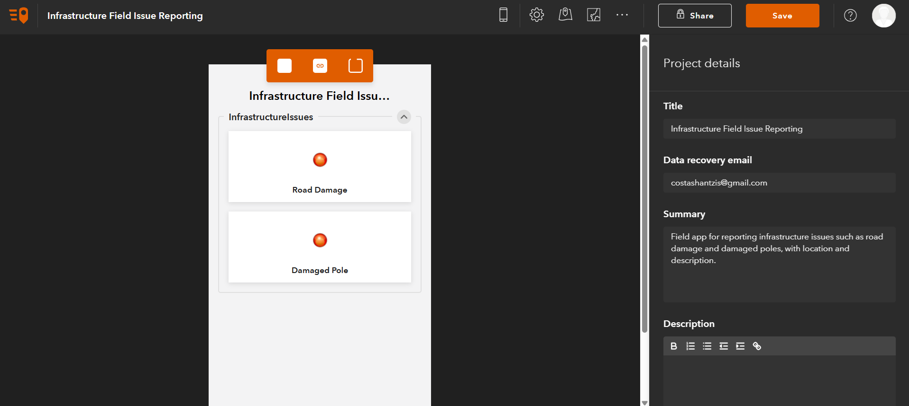
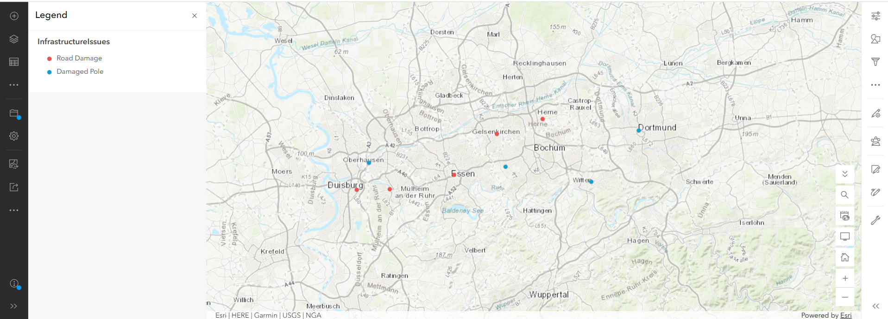
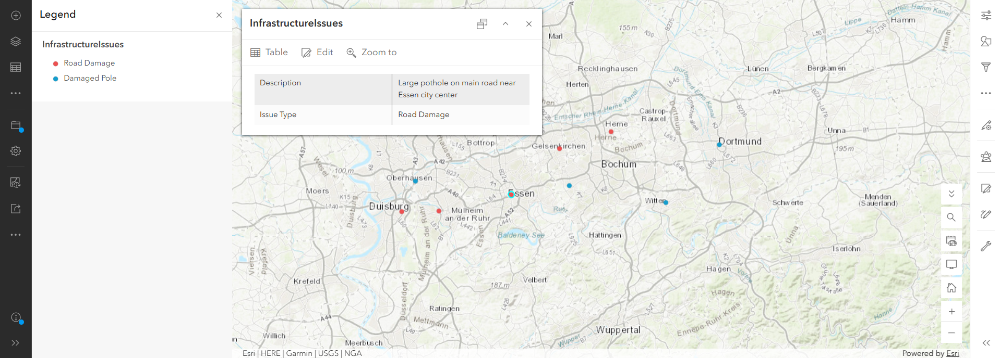
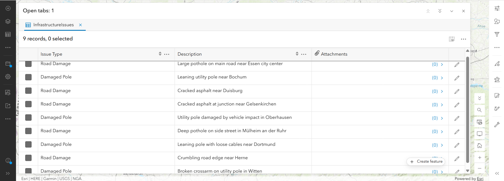

# Infrastructure Field Issue Reporting (ArcGIS QuickCapture + ArcGIS Online)

[English](#english) | [Deutsch](#deutsch)

---

## English

### Overview
A field data collection workflow for reporting infrastructure issues (road damage, damaged utility poles) in the Ruhr area, Germany. A hosted feature layer in ArcGIS Online stores the reports, an ArcGIS QuickCapture project provides one-tap reporting buttons for field staff, and a web map visualizes all reports by issue type.

### Workflow
1. Created a hosted **point feature layer** (`InfrastructureIssues`) in ArcGIS Online with the fields `Issue Type` and `Description`.
2. Built an **ArcGIS QuickCapture** project on top of the layer with two buttons: **Road Damage** and **Damaged Pole**. Each button writes a fixed `Issue Type`, while the field worker types a short `Description` (button user input).
3. Created a **web map** from the layer, enabled pop-ups, and styled the points by `Issue Type` (unique symbols, with legend).
4. Entered 9 sample reports across the Ruhr area (Essen, Duisburg, Bochum, Dortmund and others) through the Map Viewer editor to demonstrate the data flow.
5. Exported the layer to CSV for a verifiable raw-data copy.

### Result

| Issue Type | Reports |
|---|---|
| Road Damage | 5 |
| Damaged Pole | 4 |
| **Total** | **9** |

### Screenshots

**QuickCapture project (button design)**

**Web map, styled by issue type**

**Pop-up of a single report**

**Attribute table**

### Data
- [infrastructure_issues.csv](infrastructure_issues.csv): export of all 9 sample reports.

### Notes
- The reports are sample data entered for demonstration. The QuickCapture project was configured and saved, but not field-tested on a mobile device.
- The course ArcGIS account used for this project is deleted on 21 October 2026, so the screenshots and the CSV in this repository are the permanent record.

### Tools
ArcGIS Online · ArcGIS QuickCapture · Map Viewer · Hosted Feature Layers · Instant Apps (template selection)

### Source
Esri, "The ArcGIS Imagery MOOC: Foundations and Frontiers" (completed September 2026): adapted exercise, reframed from park trail reports to infrastructure field reporting.

---

## Deutsch

### Überblick
Ein Workflow zur Felddatenerfassung für Infrastrukturschäden (Straßenschäden, beschädigte Strommasten) im Ruhrgebiet. Ein gehosteter Feature-Layer in ArcGIS Online speichert die Meldungen, ein ArcGIS-QuickCapture-Projekt bietet Meldebuttons für Mitarbeitende im Feld, und eine Webkarte visualisiert alle Meldungen nach Schadensart.

### Ablauf
1. Erstellung eines gehosteten **Punkt-Feature-Layers** (`InfrastructureIssues`) in ArcGIS Online mit den Feldern `Issue Type` und `Description`.
2. Aufbau eines **ArcGIS-QuickCapture**-Projekts auf Basis des Layers mit zwei Buttons: **Road Damage** und **Damaged Pole**. Jeder Button schreibt einen festen `Issue Type`, die Beschreibung (`Description`) wird vom Mitarbeitenden eingegeben (Button-Benutzereingabe).
3. Erstellung einer **Webkarte** aus dem Layer, Aktivierung von Pop-ups und Darstellung der Punkte nach `Issue Type` (eindeutige Symbole, mit Legende).
4. Eingabe von 9 Beispielmeldungen im Ruhrgebiet (Essen, Duisburg, Bochum, Dortmund u. a.) über den Editor im Map Viewer, um den Datenfluss zu demonstrieren.
5. Export des Layers als CSV für eine nachvollziehbare Rohdatenkopie.

### Ergebnis

| Schadensart | Meldungen |
|---|---|
| Road Damage (Straßenschaden) | 5 |
| Damaged Pole (beschädigter Mast) | 4 |
| **Gesamt** | **9** |

### Screenshots

**QuickCapture-Projekt (Button-Design)**

**Webkarte, nach Schadensart dargestellt**

**Pop-up einer einzelnen Meldung**

**Attributtabelle**

### Daten
- [infrastructure_issues.csv](infrastructure_issues.csv): Export aller 9 Beispielmeldungen.

### Hinweise
- Die Meldungen sind zu Demonstrationszwecken eingegebene Beispieldaten. Das QuickCapture-Projekt wurde konfiguriert und gespeichert, aber nicht auf einem Mobilgerät im Feld getestet.
- Der für dieses Projekt genutzte Kurs-Account bei ArcGIS wird am 21. Oktober 2026 gelöscht, daher sind die Screenshots und die CSV in diesem Repository die dauerhafte Dokumentation.

### Werkzeuge
ArcGIS Online · ArcGIS QuickCapture · Map Viewer · Gehostete Feature-Layer · Instant Apps (Vorlagenauswahl)

### Quelle
Esri, "The ArcGIS Imagery MOOC: Foundations and Frontiers" (abgeschlossen September 2026): angepasste Übung, von Parkweg-Meldungen auf Infrastruktur-Felderfassung umgestaltet.
