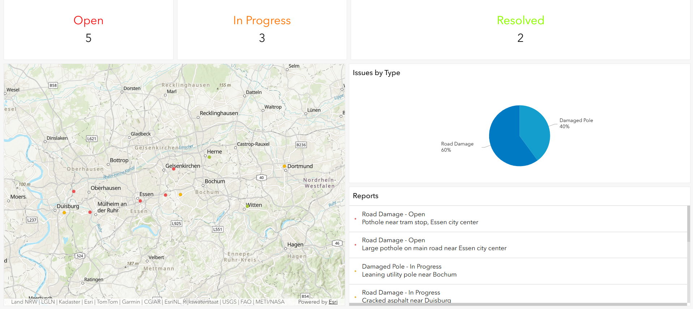
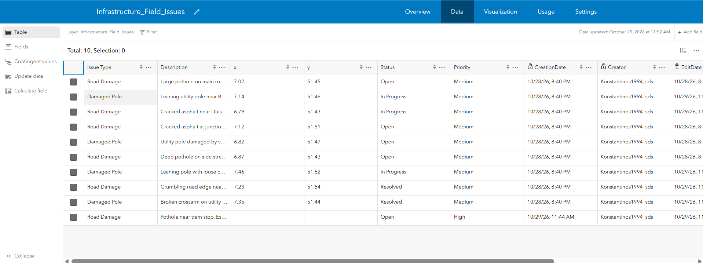
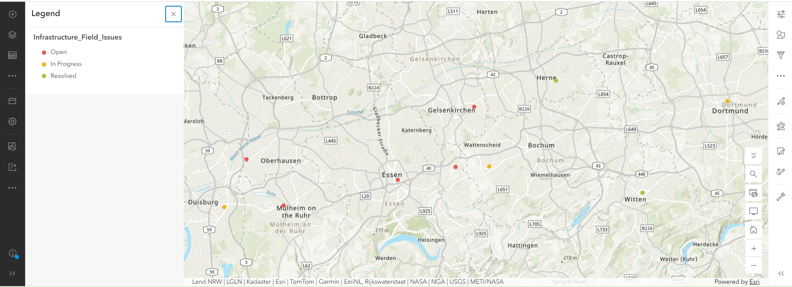
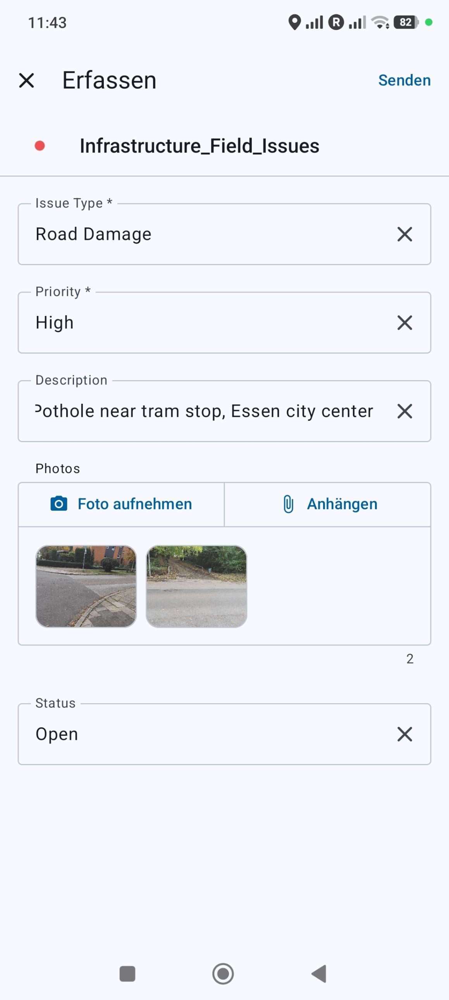
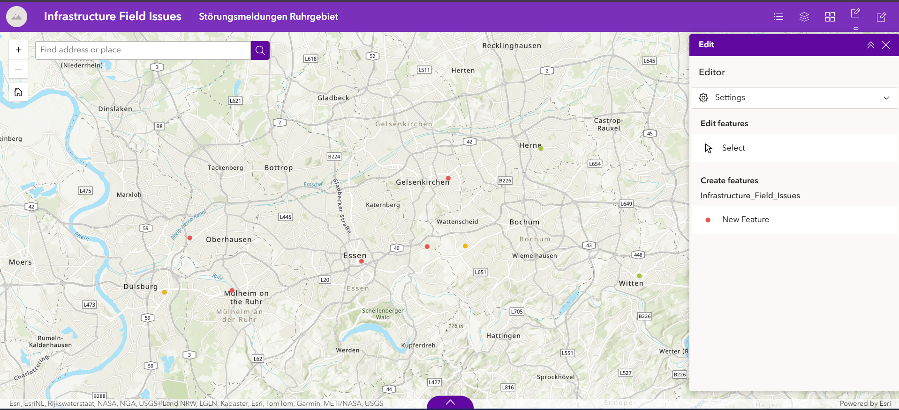
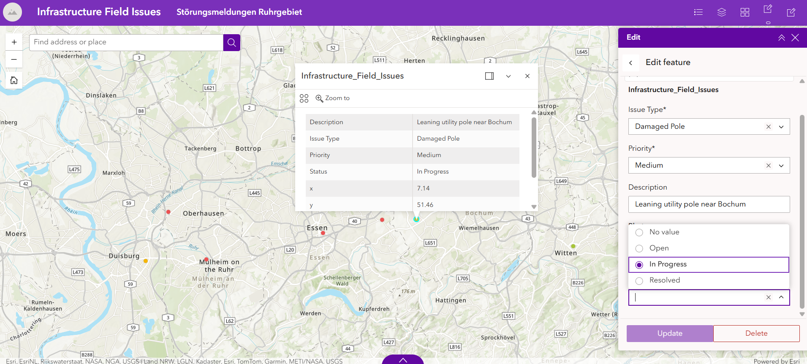

# Infrastructure Field Issue Reporting

[English](#infrastructure-field-issue-reporting) | [Deutsch](#deutsch)

End-to-end **Enterprise GIS workflow in ArcGIS Online** for reporting and managing infrastructure issues (**road damage** and **damaged utility poles**) in the **Ruhr area (NRW, Germany)**.

Field technicians capture issues with **ArcGIS Field Maps** on a smartphone, the office tracks every report through a **status workflow** (Open → In Progress → Resolved) in an **ArcGIS Dashboard**, and an **Experience Builder** web app lets operations staff update reports in the browser.



---

## Key results

| | |
|---|---|
| Study area | Ruhr area – Essen, Bochum, Duisburg, Dortmund, Gelsenkirchen, Oberhausen, Mülheim an der Ruhr, Herne, Witten |
| Reports | 10 (9 initial + 1 captured live in the field with Field Maps, incl. 2 photos) |
| Status | **5 Open · 3 In Progress · 2 Resolved** |
| Issue types | Road Damage 60 % · Damaged Pole 40 % |
| Apps | Field Maps (mobile) · Map Viewer · Dashboards · Experience Builder |

---

## Workflow

1. **Hosted feature layer** – point data (CSV, WGS84) published as an editable hosted feature layer
2. **Data model**
   - New fields **Status** (Open / In Progress / Resolved, default *Open*) and **Priority** (High / Medium / Low, default *Medium*)
   - **Coded value domains** (lists) for Issue Type, Status and Priority → no free-text errors
   - Existing records updated with **Calculate Field**
   - **GlobalID** added, **attachments** enabled for photos
3. **Editing settings**
   - Editing enabled (add, update, delete)
   - **Editor tracking** – CreationDate, Creator, EditDate, Editor are written automatically
   - **Sync** enabled for offline use in the field



4. **Web map** – features symbolised by status: red = Open, orange = In Progress, green = Resolved



5. **Field Maps form** (Field Maps Designer)
   - Logical field order: Issue Type → Priority → Description → Photos → Status
   - Issue Type and Priority are **required**
   - Drop-down lists for all coded fields, camera access for photos
   - Coordinates are not typed in – the location comes from the device GPS / map



6. **Field test** – a new report was captured on a smartphone with 2 photos; afterwards several reports were updated to *In Progress* / *Resolved* to simulate the repair process
7. **Dashboard** – status indicators (Open / In Progress / Resolved), map, pie chart by issue type and a report list linked to the map (zoom on selection); all elements update automatically
8. **Experience Builder app** – map with legend, layer list, basemap gallery and an **Edit** widget for creating new reports and changing the status in the browser





---

## Roles (recommended setup)

The MOOC account used for this project does not allow creating groups, so roles were not configured. In a real organisation the solution would be shared through two ArcGIS groups:

| Role | Group | Access |
|---|---|---|
| Field crew | *Field Crew* | Field Maps – capture new reports, add photos |
| Operations | *Operations* | Dashboard + Experience Builder app – monitor, update status |

---

## Limitations

- Demonstration data (10 reports), not real maintenance records
- Created in a temporary ArcGIS Online MOOC account – the live apps are no longer online; the screenshots document the result
- Groups and role-based sharing are described but not implemented (see above)

---

## Repository structure

```
Infrastructure-Field-Issue-Reporting/
├── images/
│   ├── 01_data_schema.png
│   ├── 02_field_maps_form.png
│   ├── 03_web_map_status.png
│   ├── 04_dashboard.png
│   ├── 05_experience_app.png
│   └── 06_status_update.png
├── LICENSE
└── README.md
```

---

## Tools

ArcGIS Online · ArcGIS Field Maps · Field Maps Designer · Map Viewer · ArcGIS Dashboards · ArcGIS Experience Builder

## License

MIT License – see [LICENSE](LICENSE)

---
---

# Deutsch

[English](#infrastructure-field-issue-reporting) | [Deutsch](#deutsch)

Durchgängiger **Enterprise-GIS-Workflow in ArcGIS Online** zur Erfassung und Bearbeitung von Störungsmeldungen an der Infrastruktur (**Straßenschäden** und **beschädigte Masten**) im **Ruhrgebiet (NRW)**.

Techniker erfassen Störungen mit **ArcGIS Field Maps** auf dem Smartphone, der Innendienst verfolgt jede Meldung über einen **Status-Workflow** (Offen → In Bearbeitung → Erledigt) in einem **ArcGIS Dashboard**, und eine **Experience-Builder**-Web-App ermöglicht die Bearbeitung der Meldungen im Browser.


---

## Zentrale Ergebnisse

| | |
|---|---|
| Gebiet | Ruhrgebiet – Essen, Bochum, Duisburg, Dortmund, Gelsenkirchen, Oberhausen, Mülheim an der Ruhr, Herne, Witten |
| Meldungen | 10 (9 Ausgangsdaten + 1 live im Feld mit Field Maps erfasst, inkl. 2 Fotos) |
| Status | **5 Open · 3 In Progress · 2 Resolved** |
| Störungsarten | Road Damage 60 % · Damaged Pole 40 % |
| Apps | Field Maps (mobil) · Map Viewer · Dashboards · Experience Builder |

---

## Arbeitsablauf

1. **Gehosteter Feature-Layer** – Punktdaten (CSV, WGS84) als bearbeitbarer Feature-Layer veröffentlicht
2. **Datenmodell**
   - Neue Felder **Status** (Open / In Progress / Resolved, Standard *Open*) und **Priority** (High / Medium / Low, Standard *Medium*)
   - **Domänen (Werte­listen)** für Issue Type, Status und Priority → keine Tippfehler
   - Bestehende Datensätze mit **Feld berechnen** aktualisiert
   - **GlobalID** ergänzt, **Anhänge** für Fotos aktiviert
3. **Bearbeitungseinstellungen**
   - Bearbeitung aktiviert (Hinzufügen, Aktualisieren, Löschen)
   - **Editor-Tracking** – CreationDate, Creator, EditDate, Editor werden automatisch geschrieben
   - **Synchronisierung** für die Offline-Nutzung im Feld


4. **Webkarte** – Darstellung nach Status: rot = Open, orange = In Progress, grün = Resolved


5. **Field-Maps-Formular** (Field Maps Designer)
   - Logische Reihenfolge: Issue Type → Priority → Description → Photos → Status
   - Issue Type und Priority sind **Pflichtfelder**
   - Auswahllisten für alle codierten Felder, Kamerazugriff für Fotos
   - Keine manuelle Eingabe von Koordinaten – die Position kommt vom GPS / aus der Karte


6. **Feldtest** – eine neue Meldung wurde mit 2 Fotos auf dem Smartphone erfasst; anschließend wurden mehrere Meldungen auf *In Progress* / *Resolved* gesetzt, um den Reparaturablauf zu simulieren
7. **Dashboard** – Statusanzeigen (Open / In Progress / Resolved), Karte, Kreisdiagramm nach Störungsart und eine mit der Karte verknüpfte Meldungsliste (Zoom bei Auswahl); alle Elemente aktualisieren sich automatisch
8. **Experience-Builder-App** – Karte mit Legende, Layerliste, Grundkarten-Galerie und **Edit**-Widget zum Erfassen neuer Meldungen und Ändern des Status im Browser


---

## Rollen (empfohlene Umsetzung)

Im verwendeten MOOC-Konto können keine Gruppen angelegt werden, daher wurden die Rollen nicht eingerichtet. In einer echten Organisation würde die Lösung über zwei ArcGIS-Gruppen geteilt:

| Rolle | Gruppe | Zugriff |
|---|---|---|
| Außendienst | *Field Crew* | Field Maps – neue Meldungen erfassen, Fotos anhängen |
| Innendienst | *Operations* | Dashboard + Experience-Builder-App – überwachen, Status ändern |

---

## Einschränkungen

- Demonstrationsdaten (10 Meldungen), keine echten Instandhaltungsdaten
- Erstellt in einem befristeten ArcGIS-Online-MOOC-Konto – die Apps sind nicht mehr online; die Screenshots dokumentieren das Ergebnis
- Gruppen und rollenbasiertes Teilen sind beschrieben, aber nicht umgesetzt (siehe oben)

---

## Werkzeuge

ArcGIS Online · ArcGIS Field Maps · Field Maps Designer · Map Viewer · ArcGIS Dashboards · ArcGIS Experience Builder

## Lizenz

MIT-Lizenz – siehe [LICENSE](LICENSE)
